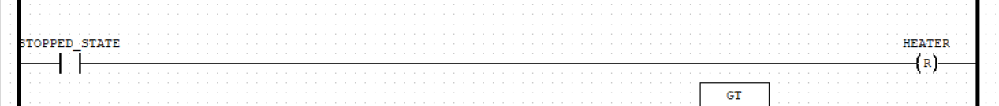
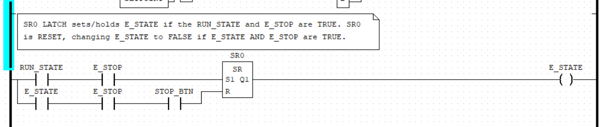
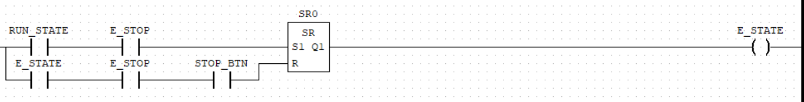
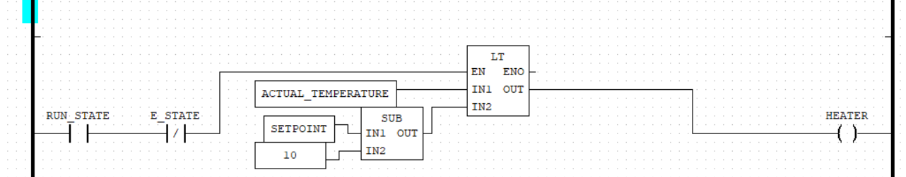

> need to update the screenshots with updated code
> modbus screenshots
> runtime screenshots
> videos of the plc at work
> move the stuff at 5 under system operations
> the variables screenshot and the variables table duplicated data (so remove one)

<i>
ITAE6.100 Automation and Embedded Systems Assignment - Part 3: Programming with a PLC By Maraea and Sara</i>

# Simple Boiler Controller

#### Table of Contents

[1.0 - Introduction](#10-introduction) 
[2.0 - Hardware and I/O Mapping](#20-hardware-and-io-mapping) 
[2.1 - I/O Mapping](#21-io-mapping) 
[3.0 - System Operations](#30-system-operations) 
[4.0 - PLC Explanations](#40-plc-explanations) 
[5.0 - Testing](#50-testing) 
[5.1 - Known Bugs](#41-known-bugs) 
[6.0 - Group Contributions](#60-group-contributions) 

## 1.0 Introduction

This report documents Part 3 of the Simple Water Boiler Controller case study. Previously, we used Logisim and CircuitPython to implement the case study logic. 
Part 3 aims to implement the case study logic using a combination of ladder diagrams (LD) and function block diagrams (FBD) using the OpenPLC software. 

We will be using the Raspberry Pico W to test the connected hardware (digital, and analogue inputs, and outputs) and to demonstrate that the PLC is functioning as intended.

## 2.0 Hardware and I/O Mapping

The system contains 7 inputs to control the associating 9 outputs. 
##### Inputs include:

1. Start / Heating ON / Setpoint
2. Stop / Heating OFF
3. Temperature Up
4. Temperature Down
5. Emergency Stop
6. Pressure Switch
7. Potentiometer(Temperature simulated with dial)

##### Outputs include:

1. Heater LED
2. Temperature Range Indicators (Relays / LED0-5)
3. Emergency LED
4. Servo(Water valve)

picture of board and inputs 

### 2.1 I/O Mapping

The following displays the input and output mapping used.

|**Inputs**|Type|Wire|Board Label|GPIO Pin|I/O Mapping|
|-|-|-|-|-|-|
|Start Button (GREEN)|Digital Input (Discrete Input Contacts)|**Red**|DI-1|6|IX0.0|
|Stop Button (RED)|Digital Input (Discrete Input Contacts)|**Green**|DI-2|7|IX0.1|
|Emergency Stop (BLACK)|Digital Input (Discrete Input Contacts)|Black|DI-3|8|IX0.2|
|Temp Up (BLUE)|Digital Input (Discrete Input Contacts)|Blue|DI-4|9|IX0.3|
|Temp Down (YELLOW)|Digital Input (Discrete Input Contacts)|Yellow|DI-5|10|IX0.4|
|Pressure Switch (DuPont)|Digital Input (Discrete Input Contacts)|Yellow DuPont|DI-6|11|IX0.5|
|Temp Dial|Analogue Input (Input Register)|Purple Grey White|GND AD0 3V3|26|IW0.0|

**Note:** Start and Stop button wires are opposite.

|**Outputs**|Type|Wire|Board Label|GPIO Pin|I/O Mapping|
|-|-|-|-|-|-|
|Heater LED|Digital Output (Discrete Output Coil)|-|DO-1 / LED4|21|QX0.0|
|LED0|Digital Output (Discrete Output Coil)|-|DO-2 / LED5|20|QX0.1|
|LED1|Digital Output (Discrete Output Coil)|-|DO-3 / LED6|19|QX0.2|
|LED2|Digital Output (Discrete Output Coil)|-|DO-4 / LED7|18|QX0.3|
|LED3|Digital Output (Discrete Output Coil)|-|DO-5 / LED8|17|QX0.4|
|LED4|Digital Output (Discrete Output Coil)|-|DO-6 / LED9|16|QX0.5|
|LED5|Digital Output (Discrete Output Coil)|-|DO-7 / LED10|15|QX0.6|
|Emergency LED|Digital Output (Discrete Output Coil)|-|DO-8 / LED11|14|QX0.7|
|Servo (Water Valve)|Analogue Output (Holding Register)|Brown Red Yellow|GND 5V PMW|4|QW0.0|

## 3.0 System Operations

> [!NOTE]  
> The following information in this section iterates the logic from the previous tasks and case study for the intended system operations. 
> Click toggle below to expand this information, or skip to [Testing](#40-testing). 

   
Click to view System Operations information

The system has 3 states. Below are the criteria to activate each state:  

**1. STOPPED_STATE**

Input functionality:
   * Temperature control buttons press: enabled
   * Start button press: enabled
   * Stop button press: disabled
   * Emergency button press: disabled
   * Pressure switch: disabled

Output functionality:
   * Heater control is disabled

**2. RUN_STATE**

Input functionality:
   * Temperature control buttons press: disabled
   * Start button: active
   * Stop button press: enabled
   * Emergency button press: enabled
   * Pressure switch: enabled

Output functionality:
   * Heater control is active

**3. EMERGENCY_STATE**

Input functionality:
   * Temperature control buttons press: disabled
   * Start button press: disabled
   * Stop button press: disabled
   * Emergency button press: active
   * Pressure switch: active emergency state

Output functionality:
   * Heater control is disabled

### 3.1 Emergency Stop

Pressing the BLACK button will activate the emergency stop ***(EMERGENCY_STATE)***. When activated, the system enters the EMERGENCY_STATE. This activates a continuous buzzer, disables the heater, and fully closes the water valve to 0%. 
**To disable the emergency stop, the BLACK and RED buttons must be pressed simultaneously.**

### 3.2 Pressure Switch

The pressure switch triggers the same emergency response as the emergency stop. When activated, the system enters the EMERGENCY_STATE. This activates a continuous buzzer, disables the heater, and fully closes the water valve to 0%.

This event is simulated using a DuPont pin to trigger the input.

### 3.2 Temperature Control

The temperature setpoint can be adjusted using the BLUE button to increase the setpoint and the YELLOW button to decrease the setpoint.

The system allows for a minimum setpoint of 80C and a maximum setpoint of 180C.

### 3.3 Start/Stop

Pressing the GREEN button activates heating, while the RED button will deactivate heating.
Heating is indicated by the output relay DO-1 / LED 4. 
If the temperature is above the SETPOINT, the heater relay / LED will turn off and vice versa. 

### 3.4 Operating Instructions 

1. Select the desired temperature using the BLUE and YELLOW buttons.
2. Press the GREEN button to set the temperature and start heating.
3. The system monitors the boiler temperature and controls the heater.
4. Press the RED button to stop heating.
5. In an emergency, press the BLACK button to activate the emergency stop.
6. To reset the emergency stop, press the BLACK and RED buttons simultaneously.

### 4.0 OpenPLC Explanations

#### 4.1 Variables

Below are the variables we specified on OpenPLC:

#### OpenPLC code screenshots

##### 4.1.1 - Line 1: STOP-BTN

STOPPED-STATE

`not RUN_STATE and not E_STATE = STOPPED_STATE`

##### 4.1.2 - Line 2: START-BTN or RUN-STATE

`not STOP-BTN and  START-BTN or RUN-STATE`

STOP_BTN negated to become TRUE when pressed, stopping/breaking the RUN_STATE logic.

##### 4.1.3 - updated code

> update the rest of the readme with the below:

line 3:

line 4: 

line 5:

##### 4.1.4 - Line 3: E-STOP

##### 4.1.10 - Line 4: HEATER

Code for heater toggling, which dictates what conditions the heater will be allowed to start in:

1. Run state must be on
2. Emergency state must be off
3. Actual temperature is within 10 degrees of the setpoint

##### 4.1.11 - Line 5: TEMPUP and TEMPDOWN

Code for setpoint increase and decrease via the TEMPUP and TEMPDWN buttons.

> included is code for disabling both the LEDs and temperature control if emergency state is currently active

##### 4.1.12 - Line 6: LED0 ->  LED5

Code for LEDs that evaluates the setpoint to activate an LED, where every even number will only activate one LED and every odd number will activate BOTH the previous LED and the next... and so forth.

##### 4.1.20 - Line 7: ACTUAL_TEMPERATURE

Code for calculating the actual temperature from normalizing the values output from the potentiometer into the 0-190 range.

Jump to [Modbus](#52---modbus) to see proof that the temperature conversion works.

##### 4.1.26 - Line 8: PWM-CONTROLLER

Automatically controls the servo, where `CHANNEL` tells the controller where the servo is, and `DUTY` the angle the servo should currently sit at.

##### 4.1.29 - Line 9: DUTY

Calculates which width/direction to push the servo/pressure valve according to the temperature. 

##### 4.1.30 - Line 10: dial_voltage

Calculates the power usage by multiplying dial value by the max power value, and then dividing by the max memory address storage size for INT type values. Previously for CircuitPython this calculation was used to calculate the ACTUAL_TEMPERATURE, which in this assignment used a more simple calculation.

##### 4.1.32 - Line 11: PID0

PID implemented with similar PID variables to our previous assignment. Uses the ACTUAL_TEMPERATURE calculation and target SETPOINT, as well as the PID variables to output a POWER variable. 

## 5.0 Testing

The following table contains evidence that each operation works as intended. Modbus and Runtime were also used to confirm that the inputs, coils, input registers and holding registers were working correctly.

|Test|Expected Result|Pass/Fail|Evidence|
|-|-|-|-|
|Blue button|Setpoint increases|Pass||
|Yellow button|Setpoint decreases|Pass||
|Green button|Activates RUN_STATE|Pass||
|Red button|Activates STOPPED_STATE|Pass||
|Black button|Activates EMERGENCY_STATE Black and Red button to disable EMERGENCY_STATE|Pass||
|DuPont (Pressure Switch)|Activates EMERGENCY_STATE|N/A|Same logic as Black Button / Emergency Stop|
|Temperature dial|Simulate temperature changes|Pass||
|Servo|Opens/closes correctly|Half Pass||
|PID Control|Controls/stabilises the temperature|Half Pass|N/A|
|Modbus|Displays inputs, coils, holding registers and input registers|Pass| |
|Runtime|Displays status of inputs, coils etc through application via Modbus|Pass||

### 5.1 Issues / Known Bugs
Struggled to get the PWM Controller working as intended with the duty cycle. Tried several calculations to get the duty percentage based on the ANGLE calculation. Currently the TEMP_DIAL calculates the ANGLE as the output variable as well as the DUTY variable which are the same except DUTY is a float, ANGLE is an INT.

Tried using SEL and MV blocks to control the servo to reset to a 0degree angle when pressed stop or emergency stop but the logic would only apply on RUN_STATE rising edge.

Also attempted to disable servo from moving while in STOPPED_STATE, which lazily worked by adding RUN_STATE to the DIV EN for DIAL to ANGLE calculation. However, the servo still moves while the system is operating in E_STATE.

It was also difficult to visualise and understand what was actually happening with the PWM Controller and PID even with Modbus Simulation and Runtime compared to the previous CircuitPython task. 

## 6.0 Group Contributions

<!--
notes:
connected by SERIAL COM11

OpenPLC logic and code explanations:

-->
