<i>
ITAE6.100 Automation and Embedded Systems Assignment - Part 3: Programming with a PLC By Maraea and Sara</i>

# Simple Boiler Controller

#### Table of Contents

[1.0 - Introduction](#10-introduction) 
[2.0 - Hardware and I/O Mapping](#20-hardware-and-io-mapping) 
[2.1 - I/O Mapping](#21-io-mapping) 
[3.0 - System Operations](#30-system-operations) 
[4.0 - PLC Explanations](#40-plc-explanations) 
[5.0 - Testing / Evidence](50#testing--evidence) 
[5.1 - Issues / Known Bugs](#51-issues--known-bugs) 
[6.0 - Group Contributions](#60-group-contributions) 

## 1.0 Introduction

This report documents Part 3 of the Simple Water Boiler Controller case study. Previously, we used Logisim and CircuitPython to implement the case study logic. 
Part 3 aims to implement the case study logic using a combination of ladder diagrams (LD) and function block diagrams (FBD) using the OpenPLC software. 

We will be using the Raspberry Pico W to test the connected hardware (digital, and analogue inputs, and outputs) and to demonstrate that the PLC is functioning as intended.

The OpenPLC code can be found here: [waterboiler](waterboiler/) 
Structured Text file used for Runtime can be found here: [waterboiler_runtime.st](waterboiler/waterboiler_runtime.st)

## 2.0 Hardware and I/O Mapping

The system contains 7 inputs to control the associating 9 outputs.  

##### Inputs include:

1. Start / Heating ON / Setpoint
2. Stop / Heating OFF
3. Temperature Up
4. Temperature Down
5. Emergency Stop
6. Pressure Switch
7. Potentiometer(Temperature simulated with dial)

##### Outputs include:

1. Heater LED
2. Temperature Range Indicators (Relays / LED0-5)
3. Emergency LED
4. Servo(Water valve)

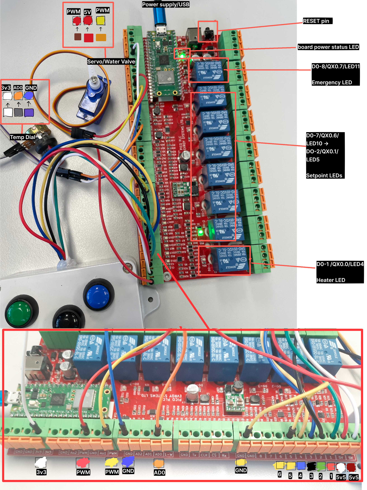

### 2.1 I/O Mapping

The following displays the input and output mapping used.

|**Inputs**|Type|Wire|Board Label|GPIO Pin|I/O Mapping|
|-|-|-|-|-|-|
|Start Button (GREEN)|Digital Input (Discrete Input Contacts)|**Red**|DI-1|6|IX0.0|
|Stop Button (RED)|Digital Input (Discrete Input Contacts)|**Green**|DI-2|7|IX0.1|
|Emergency Stop (BLACK)|Digital Input (Discrete Input Contacts)|Black|DI-3|8|IX0.2|
|Temp Up (BLUE)|Digital Input (Discrete Input Contacts)|Blue|DI-4|9|IX0.3|
|Temp Down (YELLOW)|Digital Input (Discrete Input Contacts)|Yellow|DI-5|10|IX0.4|
|Pressure Switch (DuPont)|Digital Input (Discrete Input Contacts)|Yellow DuPont|DI-6|11|IX0.5|
|Temp Dial|Analogue Input (Input Register)|Purple Grey White|GND AD0 3V3|26|IW0.0|

**Note:** Start and Stop button wires are opposite.

|**Outputs**|Type|Wire|Board Label|GPIO Pin|I/O Mapping|
|-|-|-|-|-|-|
|Heater LED|Digital Output (Discrete Output Coil)|-|DO-1 / LED4|21|QX0.0|
|LED0|Digital Output (Discrete Output Coil)|-|DO-2 / LED5|20|QX0.1|
|LED1|Digital Output (Discrete Output Coil)|-|DO-3 / LED6|19|QX0.2|
|LED2|Digital Output (Discrete Output Coil)|-|DO-4 / LED7|18|QX0.3|
|LED3|Digital Output (Discrete Output Coil)|-|DO-5 / LED8|17|QX0.4|
|LED4|Digital Output (Discrete Output Coil)|-|DO-6 / LED9|16|QX0.5|
|LED5|Digital Output (Discrete Output Coil)|-|DO-7 / LED10|15|QX0.6|
|Emergency LED|Digital Output (Discrete Output Coil)|-|DO-8 / LED11|14|QX0.7|
|Servo (Water Valve)|Analogue Output (Holding Register)|Brown Red Yellow|GND 5V PMW|4|QW0.0|

## 3.0 System Operations

> [!NOTE]  
> The following information in this section iterates the logic from the previous tasks and case study for the intended system operations. 

   
Click to view System Operations information

The system has 3 states. Below are the criteria to activate each state:  

**1. STOPPED_STATE**

Input functionality:
   * Temperature control buttons press: enabled
   * Start button press: enabled
   * Stop button press: disabled
   * Emergency button press: disabled
   * Pressure switch: disabled

Output functionality:
   * Heater control is disabled

**2. RUN_STATE**

Input functionality:
   * Temperature control buttons press: disabled
   * Start button: active
   * Stop button press: enabled
   * Emergency button press: enabled
   * Pressure switch: enabled

Output functionality:
   * Heater control is active

**3. EMERGENCY_STATE**

Input functionality:
   * Temperature control buttons press: disabled
   * Start button press: disabled
   * Stop button press: disabled
   * Emergency button press: active
   * Pressure switch: active emergency state

Output functionality:
   * Heater control is disabled

### 3.1 Emergency Stop

Pressing the BLACK button will activate the emergency stop ***(EMERGENCY_STATE)***. When activated, the system enters the EMERGENCY_STATE. This activates a continuous buzzer, disables the heater, and fully closes the water valve to 0%. 
**To disable the emergency stop, the BLACK and RED buttons must be pressed simultaneously.**

### 3.2 Pressure Switch

The pressure switch triggers the same emergency response as the emergency stop. When activated, the system enters the EMERGENCY_STATE. This activates a continuous buzzer, disables the heater, and fully closes the water valve to 0%.

This event is simulated using a DuPont pin to trigger the input.

### 3.2 Temperature Control

The temperature setpoint can be adjusted using the BLUE button to increase the setpoint and the YELLOW button to decrease the setpoint.

The system allows for a minimum setpoint of 80C and a maximum setpoint of 180C.

### 3.3 Start/Stop

Pressing the GREEN button activates heating, while the RED button will deactivate heating.
Heating is indicated by the output relay DO-1 / LED 4. 
If the temperature is above the SETPOINT, the heater relay / LED will turn off and vice versa. 

### 3.4 Operating Instructions 

1. Select the desired temperature using the BLUE and YELLOW buttons.
2. Press the GREEN button to set the temperature and start heating.
3. The system monitors the boiler temperature and controls the heater.
4. Press the RED button to stop heating.
5. In an emergency, press the BLACK button to activate the emergency stop.
6. To reset the emergency stop, press the BLACK and RED buttons simultaneously.

## 4.0 OpenPLC Explanations

#### 4.1 Variables

Below are the variables we specified on OpenPLC:

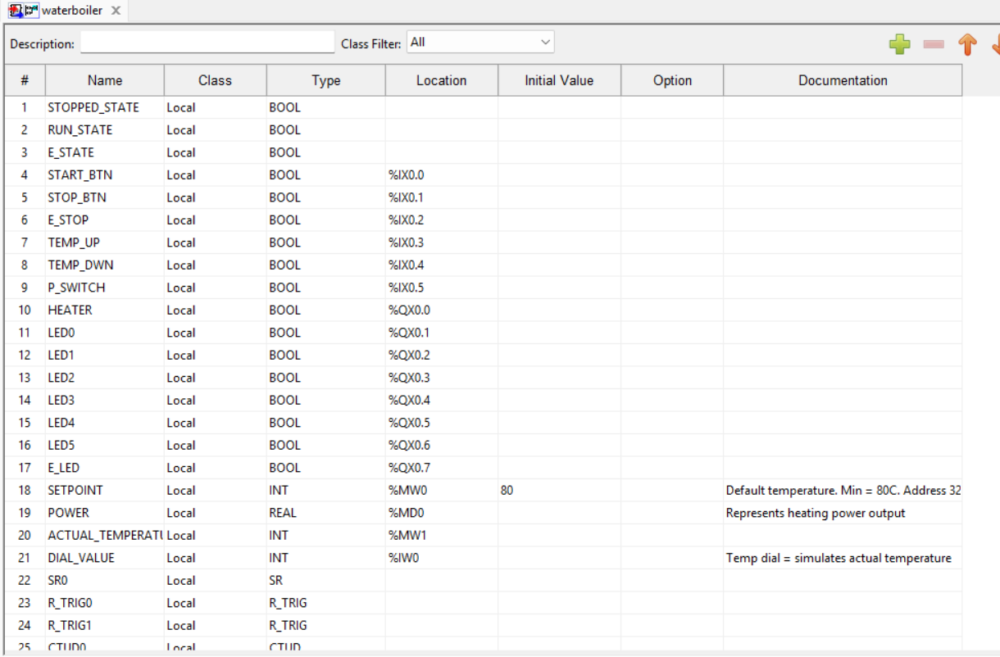
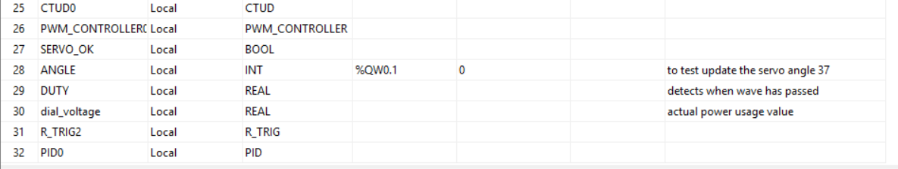
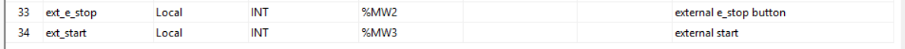

##### 4.1.1 - Line 1: START/STOP LATCH

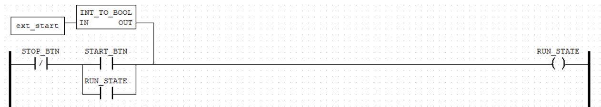

When START_BTN is pressed it triggers the RUN_STATE to be TRUE and because of the `or RUN_STATE`, it latches.
STOP_BTN negated to become TRUE when pressed, stopping/breaking the RUN_STATE logic.

##### 4.1.2 - Line 2: STOPPED_STATE

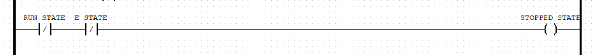

STOPPED_STATE is enabled when not in RUN_STATE and not in E_STATE.

##### 4.1.3 - Line 3: STOPPED_STATE ENABLED

While in a STOPPED_STATE the HEATER coil is reset.

##### 4.1.4 - Line 4: RUN_STATE ENABLED

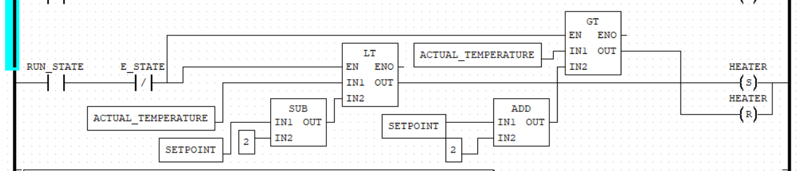

While RUN_STATE is TRUE and not E_STATE, the heater coil responds. If the ACTUAL_TEMPERATURE is less than the SETPOINT the heater will set (ON). If the ACTUAL_TEMPERATURE is greater than the SETPOINT the heater will reset (OFF). By adding SUB and ADD -+2 to each associated comparison SETPOINT, this gives a range surrounding the SETPOINT to help stabilise the ON/OFF logic of the heater LED creating a BANG BANG. This helps to minimise the LED from blinking fast when the ACTUAL_TEMPERATURE nears the SETPOINT.

##### 4.1.5 - Line 5: E_STOP

Uses a SR latch so that while in a RUN_STATE and E_STOP is pressed, the coil outputs the EMERGENCY_STATE which latches. Pressing E_STOP (Black button) and STOP_BTN (Red button) will release the latch, stopping the EMERGENCY_STATE.

##### 4.1.6 - Line 6: E_STATE ENABLED - Line 7: TEMP_UP and TEMP_DWN

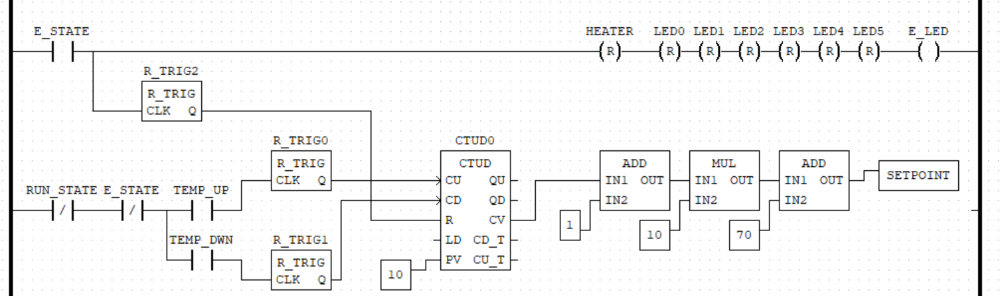

While E_STATE is enabled it turns the E LED ON and all SETPOINT LEDs and HEATER OFF. It is also connected to the CTUD R to reset the counter.

Updated screenshot to include "ext_e_Stop", which functions as an external method (through the runtime) of activating the emergency stop state:

##### Line 7: Setpoint increase and decrease via the TEMP_UP and TEMP_DWN buttons. 
Uses TRIGs to send a pulse when buttons are pressed to prevent multiple button registers. A CTUD block is used to count up and down from 0-9 range. 
Count Value is then calculated to add 1 (moving range from 1-10), multiple by 10 and add 70, giving the SETPOINT range from 80-180c. E.g. PV = 1 + 1 = 2 * 10 = 20 + 70 = 90, PV 2 = 90 etc.

##### 4.1.7 - Line 8: LED0 ->  LED5

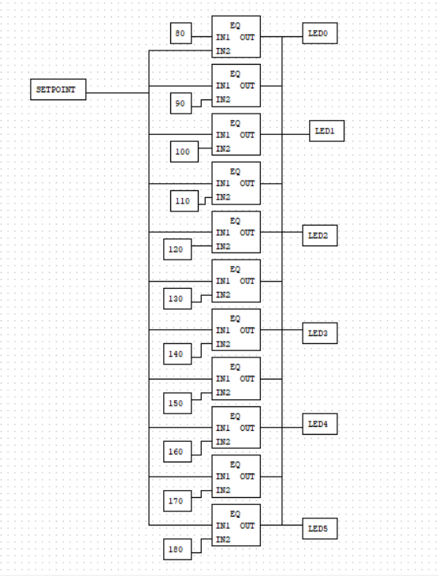

Code for LEDs that evaluates the setpoint to activate an LED, where every even number will only activate one LED and every odd number will activate BOTH the previous LED and the next... and so forth. Implemented using EQ blocks and wires as OR gates for odd number logic.

##### 4.1.8 - Line 9: ACTUAL_TEMPERATURE

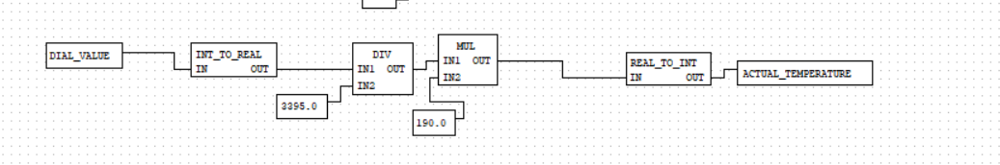

Code for calculating the simulated temperature from normalizing the values output from the potentiometer into the 0-190 range.
Takes the current dial value and subtracts the minimum reading (355) from the Analogue Input Modbus, divided by the maximum reading (3416 - 355 = 3061), times 170, plus 20 = ACTUAL_TEMPERATURE. Which gives a reading memory reading on Modbus (address 32) as approximately 20c - 190c range for ACTUAL_TEMPERATURE.

Jump to [Testing / Evidence](#50-testing--evidence) to see proof that the temperature conversion works.

##### 4.1.9 - Line 10: PWM-CONTROLLER

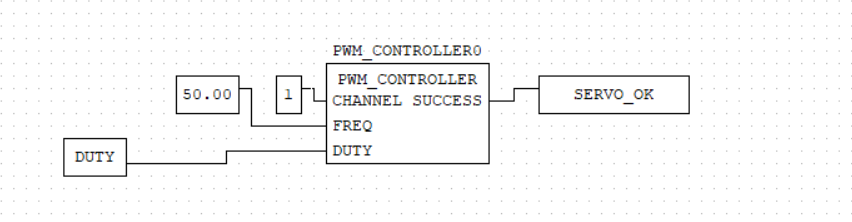

Automatically controls the servo, where `CHANNEL` tells the controller where the servo is, and `DUTY` the angle the servo should currently sit at.

##### 4.1.10 - Line 11: dial_voltage

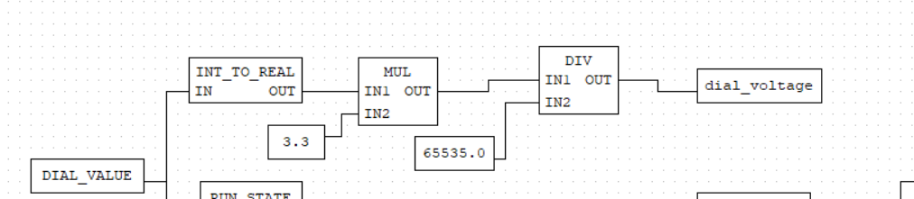

Calculates the power usage by multiplying dial value by the max power value, and then dividing by the max memory address storage size for INT type values. Previously for CircuitPython this calculation was used to calculate the ACTUAL_TEMPERATURE, which in this assignment used a more simple calculation.

##### 4.1.11 - Line 12: DUTY

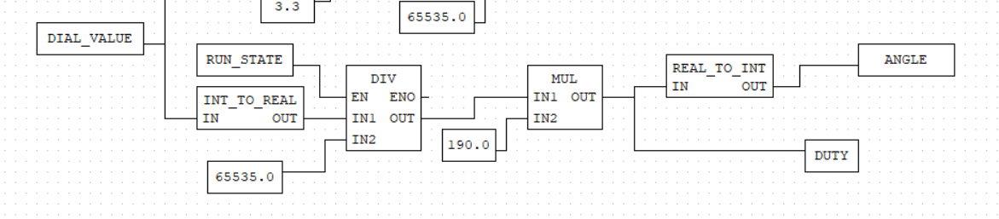

Calculates which width/direction to push the servo/pressure valve according to the temperature. 

##### 4.1.12 - Line 13: PID0

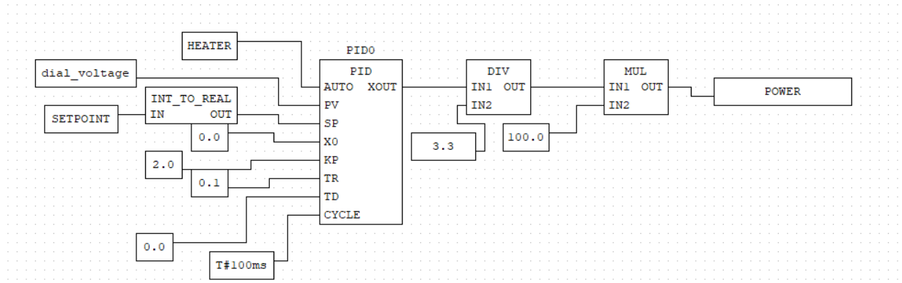

PID implemented with similar PID variables to our previous assignment. Uses the ACTUAL_TEMPERATURE calculation and target SETPOINT, as well as the PID variables to output a POWER variable. 

## 5.0 Testing / Evidence

The following table contains evidence that each operation works as intended. Modbus and Runtime were also used to confirm that the inputs, coils, input registers and holding registers were working correctly.

|Test|Expected Result|Pass/Fail|Evidence|
|-|-|-|-|
|Blue button|Setpoint increases|Pass||
|Yellow button|Setpoint decreases|Pass||
|Green button|Activates RUN_STATE|Pass||
|Red button|Activates STOPPED_STATE|Pass||
|Black button|Activates EMERGENCY_STATE Black and Red button to disable EMERGENCY_STATE|Pass||
|DuPont (Pressure Switch)|Activates EMERGENCY_STATE|N/A|Same logic as Black Button / Emergency Stop|
|Temperature dial|Simulate temperature changes|Pass||
|Servo|Opens/closes correctly|Half Pass||
|PID Control|Controls/stabilises the temperature|Half Pass|N/A|
|Modbus|Displays inputs, coils, holding registers and input registers|Pass| |
|Runtime|Displays status of inputs, coils etc through application via Modbus|Pass||

### 5.1 Issues / Known Bugs
1. Struggled to get the PWM Controller working as intended with the duty cycle. Tried several calculations to get the duty percentage based on the ANGLE calculation. Currently the TEMP_DIAL calculates the ANGLE as the output variable as well as the DUTY variable which are the same except DUTY is a float, ANGLE is an INT.

2. Tried using SEL and MV blocks to control the servo to reset to a 0degree angle when pressed stop or emergency stop but the logic would only apply on RUN_STATE rising edge.

3. Also attempted to disable servo from moving while in STOPPED_STATE through a quick fix by adding RUN_STATE to the division function block EN in the DIAL to ANGLE calculation. However, the servo still moves while the system is operating in E_STATE.
- In retrospect, this was incorrect, and a *potential* workable solution would have been to replicate the DIAL_VALUE into a clone variable to store the value (defaulted at 0) ONLY if RUN_STATE was on (otherwise we'd reset it to zero), and THEN do the calculations (still restricted by RUN_STATE) which in theory, would successfully restrict the servo's functionality to only while RUN_STATE is true.

4. It was difficult to visualise and understand what was actually happening with the PWM Controller and PID even with Modbus Simulation and Runtime compared to the previous CircuitPython task, and so a big struggle we had was data analysis and debugging in general (recording the power output, PWM controller...).   We attempted to use Modbus to analyze data to see if our maths were working correctly and frequently ran into mathematical issues where variables we used to record on modbus i.e. POWER to show how much power was being used (similar to our code in Python) would try to display numbers in the negatives, shoot up from 0 to 25565, and/or only show zero. In retrospect, we know now that it's because of the memory address size for MW and that there were issues with buffer overflow and 0. numbers.

- A solution we used to try and solve this (before utilizing the %MD addresses) was to convert the current value into a percentage out of 100, which also didn't work. We later removed this from our code.

5. Translating our circuitpython logic and calculations into LD and FBD was especially tedious and the constant attempts at debugging and breaking down + writing calculations ate up a lot of time, and it was hard to find information online that could help us when we struggled to understand something.

## 6.0 Group Contributions

Sara provided the initial OpenPLC code with all states, buttons, LED functionality working, and also fixed the servo as it was not working for a while, did the runtime part of the assignment and also helped explain aspects of the assignment that were hard to understand, kept the code tidy, did the documentation and also helped resolve a lot of issues.  
Maraea worked on the initial calculations required in the assignment like PID, temperature normalization, dial to dictate servo angle, modbus to analyze data (and check if the calculations were correct), and also helped on the documentation.
