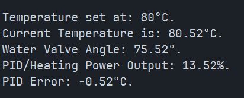

1. STOPPED_STATE

Input functionality:

<<<<<<< HEAD
    Temperature control buttons press: enabled
    Start button press: enabled
    Stop button press: disabled
    Emergency button press: disabled
    Pressure switch: disabled

2. RUN_STATE
=======
**2. RUN_STATE**
>>>>>>> 31b10588f785ae1e7243a63144ea9f9687be44a8

Input functionality:

<<<<<<< HEAD
    Temperature control buttons press: disabled
    Start button: active
    Stop button press: enabled
    Emergency button press: enabled
    Pressure switch: enabled

3. EMERGENCY_STATE
=======
**3. EMERGENCY_STATE**
>>>>>>> 31b10588f785ae1e7243a63144ea9f9687be44a8

Input functionality:

<<<<<<< HEAD
    Temperature control buttons press: disabled
    Start button press: disabled
    Stop button press: disabled
    Emergency button press: active
    Pressure switch: active emergency state
=======
## 4.0 Safety Operations

### 4.1 Emergency Stop

> [!CAUTION]
> Pressing the BLACK button will activate the emergency stop ***(EMERGENCY_STATE)***. When activated, the system enters the EMERGENCY_STATE. This activates a continuous buzzer, disables the heater, and fully closes the water valve to 0%. 
> To disable the emergency stop, the BLACK and RED buttons must be pressed simultaneously.

### 4.2 Pressure Switch

The pressure switch triggers the same emergency response as the emergency stop. When activated, the system enters the EMERGENCY_STATE. This activates a continuous buzzer, disables the heater, and fully closes the water valve to 0%.

This event is simulated using a DuPont pin to trigger the input.

## 5.0 Control Operations

### 5.1 Temperature Control

The temperature setpoint can be adjusted using the BLUE button to increase the setpoint and the YELLOW button to decrease the setpoint.

The system allows for a minimum setpoint of 80C and a maximum setpoint of 180C.

### 5.2 Start/Stop

Pressing the GREEN button activates heating, while the RED button will deactivate heating.
Heating is indicated by the output relay ***RO1***. 
If the temperature is above the SETPOINT, the heater relay (LED1) will turn off and vice versa. 
The range is indicated by the implemented bang-bang control, controlling the heater within a range of 2C.

### 5.3 Operating Instructions 

1. Select the desired temperature using the BLUE and YELLOW buttons.
2. Press the GREEN button to set the temperature and start heating.
3. The system monitors the boiler temperature and controls the heater.
4. Press the RED button to stop heating.
5. In an emergency, press the BLACK button to activate the emergency stop.
6. To reset the emergency stop, press the BLACK and RED buttons simultaneously.

The REPL will display feedback for each valid action.

### 5.4 Operations Testing

The following table contains evidence that each operation works as intended.

|Test|Expected Result|Pass/Fail|Evidence|
|-|-|-|-|
|Blue button|Setpoint increases|Pass|[temp up/down](./images/tempup_tempdown.MOV)|
|Yellow button|Setpoint decreases|Pass|[temp up/down](./images/tempup_tempdown.MOV)|
|Green button|Activates RUN_STATE|Pass|[start/stop](./images/start_stop.MOV)|
|Red button|Activates STOPPED_STATE|Pass|[start/stop](./images/start_stop.MOV)|
|Black button|Activates EMERGENCY_STATE|Pass|[emergency stop](./images/emergency.MOV)|
|DuPont (Pressure Switch)|Activates EMERGENCY_STATE|Pass|[pressure switch](./images/pressure-switch)|
|Temperature dial|Simulate temperature changes|Pass|[dial & servo](./images/dial_servo.MOV)|
|PID Control|Controls/stabilises the temperature|Pass|[REPL screen recording displaying heating outputs](./images/REPL_output.mp4)|
|Servo|Opens/closes correctly|Pass|[dial & servo](./images/dial_servo.MOV)||

## 6.0 PID Control

A PID controller was implemented to control the simulated boiler temperature.
The controller compares the selected temperate setpoint with the temperature provided by the simulation dial and adjusts the heater output based on the temperature error.

The PID controller was tested by observing the boiler temperature as it approached the selected setpoint.

### 6.1 PID Parameters

Current PID Parameters being used: 

Kp: 2
Ki: 0.001
Kd: 0.01

The PID parameters were adjusted through testing to achieve a low error when the boiler temperature reaches the desired setpoint.

### 6.2 PID Testing 

To test how the PID works, the Kp, Ki and Kd was each changed incrementally to output a minimal temperature error when the boiler temperature reaches the setpoint. 

Challenges were experienced when changing these inputs to received the correct results. Firstly, the PID, specifically the Ki was too high and therefore the PID heating output completely overshot the desired setpoint, resulting in the following screenshot where the heating output is 13.52% when the temperature 80.52C had already reached the setpoint 80C. 
To fix this the values were adjusted, resulting in the final PID parameters mentioned above.
 The following are the parameters tested that resulted in the following image: 

PID Parameters tested and failed:

Kp: 2 
Ki: 0.02 
Kd: 0.01 

The following screen recording displays the Heating Control Status and outputs the PID % and temperature error. 

### 6.3 PID Suitability

PID control can be suitable for embedded systems such as smart water boilers, where a microcontroller can continuously monitor temperature and adjust the heating output. This is especially important for industrial water-heating systems, where accurate temperature control is required. 
 
However, PID is not always necessary. A basic domestic water heater may only require a simple bang-bang (ON/OFF) control method to maintain the temperature within an acceptable range.
 
For this project, both PID and bang-bang control were implemented. Because our system uses a simple ON/OFF LED to simulate the heater, bang-bang is more suitable for this scenario.
 

## 7.0 Group Contribution / Progress report

 
For this assessment, we had to program code that would work on a microcontroller to fulfill the requirements as specified in the assignment handout for a smart water boiler.
We worked on this part of this assessment for all of weeks 7-8.
 
Both members participated and contributed for every step of the project such as the hardware wiring, implementing CircuitPython code, testing PID controller, recording evidence and documentation during this project.
 

### 7.1 Challenges we faced: 

- bang-bang not working correctly
    - managed to fix it by revising the logic and correcting if statements

- mismatched hardware
    - red wire went to the green button and green wire went to the red button
    - fixed by swapping the wires around, but caused a lot of confusion for the first half of trying to program the board

- PID 
    - entering different numbers would overshoot the heater and cause errors
    - implementation was super confusing to understand, but would be completed by Sara - Maraea

- angle out of range:
    - had issues with the servo where the angle variable parsed to the servo would throw an error. fixed by wrapping in a "run only if within range"

### 7.2 Member contribution:

#### Sara:

Did majority of coding, refactoring and made code more comprehensive, and implemented the PID controller. Also helped to explain aspects of the assignment which were otherwise hard to understand.
Brought board home so she could work on it in her own time.

- cleaned up code and made it more presentable and easier to read
    - implemented start-up instructions interface (with the help text)
    - fixed state logic (and adjusted names and functions to fit assignment requirements and circuit diagram) 
- had a lot more understanding of the requirements in the assignment, and helped to incorporate it into the code (Water valve/servo (what the valve should do, etc), bang-bang, PID controller)
- created and troubleshooted code in her own time at home
- handled coding the outputs (setting up the temperature LEDs, heater, etc).

#### Maraea:

Wrote initial code to be built on in later iterations (first working iteration of the code, implementing bang-bang logic and "if temp within range of setpoint + or - 2 degrees" ... etc). Worked on it on the mondays, tuesdays and wednesdays of week 7 and 8.

- initial coding and logic setup
    - created state logic: RUNNING, OFF, HEATING, EMERGENCY, etc. Implemented as switches, but further refined by Sara.
    - implemented bang-bang logic: when temp goes over setpoint, heater is automatically turned off and vice versa

## 8.0 References

Copper280z (2021). *Water Boiler Example*. GitHub. https://github.com/Copper280z/CircuitPython_simple-pid/blob/master/examples/water_boiler/README.md
>>>>>>> 31b10588f785ae1e7243a63144ea9f9687be44a8
